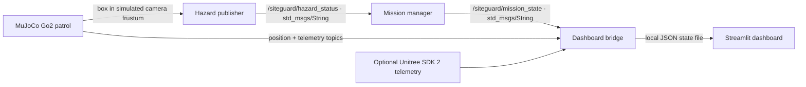

# SITEGUARD-AI

**Simulation-oriented prototype for human-supervised inspection workflows**

SITEGUARD-AI explores a ROS 2 mission workflow for a Unitree Go2 inspection concept. The repository contains prototype ROS 2 nodes, a read-only Streamlit dashboard, and a MuJoCo scene that loads the official Go2 model and detects marked boxes along a scripted patrol.

## Project status

| Area | Status in this repository |
| --- | --- |
| ROS 2 mission manager | Prototype. Publishes `PATROL` or `SAFE_STOP` from the latest hazard message. |
| Hazard input | Prototype timer demo, or the MuJoCo scene's geometry-based box detector. Neither is validated perception. |
| MuJoCo Go2 simulation | Included. Official Go2 MJCF and meshes, three marked boxes, physics simulation for joints and contacts, and a scripted kinematic base patrol. |
| Unitree telemetry bridge | Optional, read-only adapter for Unitree SDK 2 sport-mode telemetry. |
| Dashboard bridge and Streamlit UI | Prototype. Displays mission state and simulation telemetry from a local JSON file. |
| Physical robot operation | Not implemented or validated. No motion command interface is provided. |

The box detector applies a simple orange-color mask to rendered pixels from the simulated front camera. It is not a trained object detector. The base follows a scripted kinematic path, not a validated walking controller. This project remains a simulation prototype and has not been validated on a physical robot.

## Architecture



See [System Architecture](docs/system-architecture.md) and [Mission Workflow](docs/mission-workflow.md).

## Requirements

- Ubuntu with ROS 2 Humble and `colcon` for the ROS 2 path
- Python 3.10 or newer
- MuJoCo Python bindings and NumPy for simulation
- Streamlit and Plotly for the dashboard
- Optional Unitree SDK 2 Python bindings and DDS configuration for physical or SDK telemetry

The Go2 model files come from the pinned Unitree Robotics [`unitree_mujoco`](https://github.com/unitreerobotics/unitree_mujoco) submodule. The upstream BSD 3-Clause license remains in the submodule's `LICENSE` file; provenance is documented in [third-party notices](simulation/THIRD_PARTY_NOTICES.md).

Initialize the model submodule after cloning:

```bash
git submodule update --init --depth 1
```

## Build the ROS 2 package

From the repository root in a ROS 2 Humble environment:

```bash
source /opt/ros/humble/setup.bash
python3 -m pip install -U colcon-common-extensions
colcon build --base-paths src
source install/setup.bash
```

Run the mission manager and dashboard bridge in separate sourced terminals:

```bash
ros2 run siteguard_mission mission_manager
ros2 run siteguard_mission dashboard_bridge
```

## Run the MuJoCo Go2 box patrol

Create a Python environment that can access ROS 2's system packages, install the simulator dependencies, and start the interactive simulation:

```bash
python3 -m venv --system-site-packages .venv
source .venv/bin/activate
python -m pip install -r simulation/requirements.txt
python simulation/run_go2_box_patrol.py
```

The MuJoCo viewer shows the Go2 model and three orange target boxes. The scripted patrol stops when the camera image contains enough orange pixels to indicate a box. To run without the viewer on a headless Linux machine with EGL support:

```bash
MUJOCO_GL=egl python simulation/run_go2_box_patrol.py --headless --duration 40
```

The box detector uses color segmentation on the rendered front-camera image. It does not classify arbitrary objects or use a trained model. The base motion is scripted, while the Go2 joints and contacts are simulated by MuJoCo.

## Connect simulation, ROS 2, and dashboard

With the ROS 2 package built, start `mission_manager` and `dashboard_bridge` as above. In another terminal, run:

```bash
source /opt/ros/humble/setup.bash
source install/setup.bash
source .venv/bin/activate
python simulation/run_go2_box_patrol.py --ros2
```

Start Streamlit in another terminal:

```bash
python -m pip install streamlit plotly
streamlit run src/siteguard_mission/dashboard.py
```

Do not run the separate `hazard_detector` timer node alongside the MuJoCo node. Both publish `/siteguard/hazard_status` and would compete as inputs to the mission manager. The dashboard bridge writes to `~/.local/state/siteguard/dashboard_state.json` by default. Set `SITEGUARD_STATE_FILE` to change that path in both bridge and dashboard processes. The dashboard is read-only.

## Optional Unitree telemetry

The separate telemetry bridge subscribes to Unitree SDK 2's `rt/sportmodestate` channel and republishes a JSON snapshot. It is read-only, does not drive the mission manager, and requires SDK installation plus a reachable DDS endpoint. Its current default interface is `lo`.

## Topics

| Topic | ROS type | Publisher | Purpose |
| --- | --- | --- | --- |
| `/siteguard/hazard_status` | `std_msgs/msg/String` | MuJoCo node or timer demo | `NO_HAZARD` / `HAZARD_DETECTED` |
| `/siteguard/mission_state` | `std_msgs/msg/String` | Mission manager | `PATROL` / `SAFE_STOP` |
| `/siteguard/sim_position` | `std_msgs/msg/Float32` | MuJoCo node | Scripted patrol x-position |
| `/siteguard/go2/telemetry` | `std_msgs/msg/String` | MuJoCo node or optional SDK bridge | JSON telemetry snapshot |

Full component map: [SDK and Component Mapping](docs/sdk-component-mapping.md).

## Deliverables

- [System architecture](docs/system-architecture.md)
- [Mission workflow](docs/mission-workflow.md)
- [SDK and component mapping](docs/sdk-component-mapping.md)
- [Safety and ethics](docs/safety-ethics.md)
- [Submission status](docs/submission-status.md)
- [Specification deck](docs/SITEGUARD-AI-specification.pptx)

## Limitations

The prototype does not implement learned object recognition, localization, path planning, a validated quadruped gait controller, safety-rated stopping, or physical robot control. `SAFE_STOP` stops the scripted simulation patrol and changes the ROS 2 mission state; it does not issue a hardware emergency stop.

## License

The Python package metadata labels the project code Apache-2.0, but the repository does not currently include a project `LICENSE` file. Confirm the intended project license and add its full text before redistribution. The separately licensed Unitree model files retain their BSD 3-Clause notice.
