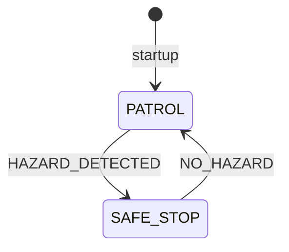

# Mission Workflow

The MuJoCo workflow demonstrates a state change when orange box pixels appear in the rendered Go2 camera image. The simulation holds the scripted base at the detection location and publishes `HAZARD_DETECTED`; the ROS 2 manager transitions to `SAFE_STOP`. The alternate timer detector remains available for a simple software-only demonstration. `SAFE_STOP` does not invoke a hardware emergency stop or establish a safety-rated condition.

## Transition table

| Current state | Input | Next state | Behavior in code |
| --- | --- | --- | --- |
| Startup | Node initialization | `PATROL` | Mission manager initializes its state to `PATROL`. |
| `PATROL` | `HAZARD_DETECTED` | `SAFE_STOP` | Logs a warning and publishes `SAFE_STOP` on the next timer tick. |
| `SAFE_STOP` | `NO_HAZARD` | `PATROL` | Logs that the hazard cleared and resumes the `PATROL` state label. |
| Any | Unknown string | unchanged | The callback ignores values other than the two recognized strings. |

The MuJoCo detector applies a simple color threshold to rendered camera pixels. It can detect the orange demo boxes, but it is not a trained object detector and does not estimate distance. The timer node remains synthetic. The manager resumes patrol immediately after `NO_HAZARD`, without operator acknowledgement, persistence checks, or a recovery procedure.
