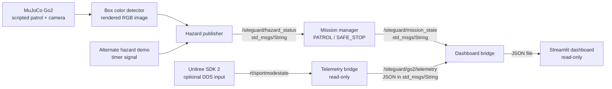

# System Architecture

## Scope

This diagram reflects the code included in the repository. It shows the MuJoCo box detector, the alternate timer-based demo source, the ROS 2 state manager, optional SDK telemetry, and the local-file dashboard path.

## Component responsibilities

| Component | Input | Output | Current boundary |
| --- | --- | --- | --- |
| MuJoCo simulation | Go2 MJCF, meshes, scene | Box geometry and simulated robot state | Base follows scripted kinematic path; joint contacts and physics are simulated. |
| Box detector | Rendered RGB frame from the Go2 camera | `/siteguard/hazard_status`, `/siteguard/sim_position`, `/siteguard/go2/telemetry` when ROS 2 mode is enabled | Thresholds orange pixels and returns a bounding box. Not a trained detector; no object classification or range estimate. |
| Alternate hazard demo | Timer | `/siteguard/hazard_status` | Repeating synthetic signal. Do not run at the same time as the MuJoCo publisher. |
| Mission manager | Hazard status | `/siteguard/mission_state` | Changes between `PATROL` and `SAFE_STOP` based on the latest string value. |
| Telemetry bridge | Unitree SDK 2 DDS sport-mode state | `/siteguard/go2/telemetry` | Optional, read-only telemetry. No robot command path. |
| Dashboard bridge | Mission state, hazard status, optional telemetry and optional sim position | Local JSON file | Stores a rolling event history and current values for the UI. |
| Streamlit dashboard | Local JSON file | Browser display | Read-only visualization. It does not send ROS commands. |

## Message flow

1. The MuJoCo node advances the Go2 scene, renders the front camera and thresholds orange pixels. The alternate timer node can instead publish a demo status.
2. The mission manager publishes its current state every two seconds and enters `SAFE_STOP` when it receives `HAZARD_DETECTED`.
3. The dashboard bridge serializes subscribed values to a local JSON state file.
4. Streamlit reads that file and renders the latest state and event history.
5. If Unitree SDK 2 is configured, the telemetry bridge publishes a JSON snapshot from `rt/sportmodestate`.

## Integration gaps

- The patrol controller moves the robot base along a scripted path. It is not a validated quadruped locomotion controller.
- Box detections use a simple orange-color pixel mask. It does not identify other object classes or estimate range.
- The Unitree SDK bridge depends on external SDK installation and DDS configuration.
- The state messages are unvalidated strings. The prototype has no timestamp, confidence, source identifier, or stale-data policy in its ROS message contract.
